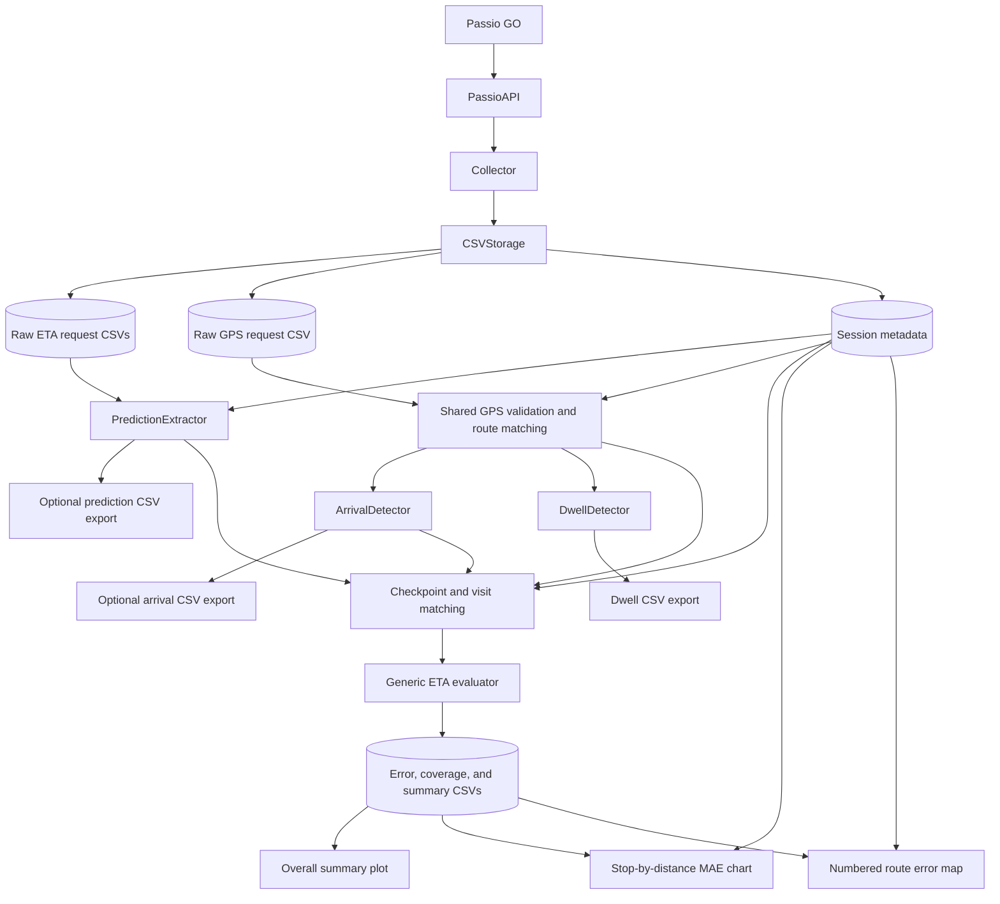

# Shuttle Analysis Architecture

## Goal

Measure Passio GO ETA prediction error when a bus is 1, 2, 3, or 4 stops away.
For `A → B → C → D`, A is three stops away from D. Evaluation uses detected
arrivals at upstream stops as checkpoints; it does not classify arbitrary
positions between stops.

```text
signed error = predicted arrival time - estimated actual arrival time
absolute error = abs(signed error)
```

Collection and analysis support only Boston Daytime and Saferide Boston East.
The arrival detector has a separate stop-segment table for each.
Checkpoint matching and evaluation are implemented; results use GPS-estimated arrivals.

## Layout

```text
Project-Work/
├── README.md
├── requirements.txt
├── shuttle_analysis/
│   ├── storage.py
│   ├── collection/
│   │   ├── passio_api.py
│   │   └── collector.py
│   ├── processing/
│   │   ├── shared/
│   │   │   ├── route_geometry.py
│   │   │   ├── route_matching.py
│   │   │   ├── stop_segments.py
│   │   │   └── vehicle_positions.py
│   │   ├── arrivals/
│   │   │   ├── arrival_detector.py
│   │   │   └── review_arrivals.py
│   │   ├── dwell/
│   │   │   ├── dwell_detector.py
│   │   │   └── review_dwells.py
│   │   └── predictions/
│   │       ├── prediction_extractor.py
│   │       └── review_predictions.py
│   └── evaluation/
│       ├── prediction_matching.py
│       ├── eta_evaluator.py
│       ├── evaluate_passio.py
│       ├── plot_evaluation.py
│       ├── plot_stop_errors.py
│       └── plot_stop_map.py
├── tests/
├── docs/
├── results/
│   ├── arrivals/
│   ├── dwell/
│   ├── predictions/
│   └── evaluation/
│       └── passio/
│           ├── errors/
│           ├── coverage/
│           ├── summaries/
│           └── plots/
│               ├── passio_summary_all.png / .pdf
│               ├── stops/
│               └── maps/
└── data/
    ├── eta_predictions.csv
    ├── eta_predictions_by_route.csv
    ├── bus_positions.csv
    ├── actual_arrivals.csv
    └── sessions/<session_id>.json
```

Package directories contain `__init__.py` files. Collected observations stay in
`data/`; generated arrival, dwell, and prediction CSVs go in `results/`.

## System diagram

The evaluator rebuilds arrivals and predictions from raw observations in memory.
Standalone processing runners export the same records for inspection; evaluation
does not read their derived CSVs. Dwell is a separate analysis and is not an input
to the current ETA evaluator.



## Data collection

`PassioAPI` holds the system ID, primary route ID, URL, and timeout. Its methods
make one request and return the complete decoded JSON:

| Method | Responsibility |
| --- | --- |
| `get_etas(stop_id, route_id=None)` | Request predictions for a stop and optional route override |
| `get_vehicles()` | Request system-wide vehicle records |
| `get_stops()` | Request stops, route order, and route coordinates |

HTTP/JSON failures propagate to the collector. No polling or file writing belongs
in the API client. MIT's system ID is 94; the primary Boston Daytime route is 71342.
The tested requests use `position=0` for ETA and `getStops=2` / `getBuses=2` for
metadata/vehicles; the exact meanings of those numeric parameters remain unverified.

The collector's startup creates a session ID, fetches metadata, discovers Boston
Daytime and Saferide Boston East, and saves the configuration plus full response.
Each cycle requests vehicles once, then ETAs for unique stops on reported active
configured routes. Shared stops are requested separately for each route. It follows
assignments rather than switching at fixed clock times.

If vehicle retrieval fails, use the last known active routes; before a usable
response, fall back to all configured routes. A usable response with no active
configured routes collects GPS only. GPS records for other routes are preserved.

Each request is timestamped and saved immediately. Request failures are saved and
collection continues; storage failures stop the collector. `run()` targets 30 seconds
between cycle starts, including collection/writing time. Overruns begin the next
cycle immediately. Ctrl+C stops the loop. ETA and GPS share one polling cycle.

## Storage

`CSVStorage` owns collection-file access. Writes append, headers are checked, and
complete decoded responses are stored as JSON strings. One row represents a
request, potentially containing several buses or predictions.

Original ETA and vehicle files use:

```text
session_id, request_started_at, request_finished_at,
response_received_at, stop_id, data, error
```

Route-aware ETA requests use a separate file without rewriting historical data:

```text
session_id, route_id, request_started_at, request_finished_at,
response_received_at, stop_id, data, error
```

Failed requests store JSON null plus an error description. Successful empty results
are different from failures. Internal API warnings stay in the preserved response.
Receipt time is measured after decoding; it is not the GPS fix time.

`read_observations("eta")` supports both ETA files. `read_observations("vehicles")`
restores vehicle observations. Readers attach session identity and source references.
Snapshots include the primary route, collection routes/stops, intervals, timeout,
metadata-request times, and the original stop/route metadata.

## Arrival detection

`ArrivalDetector(snapshot, radius_m=30, stop_segments=None)` consumes vehicle
observations and returns a list of small arrival dictionaries. It does no file I/O.

The class initializes route/stop positions, delegates GPS projection to the shared
matcher, and detects arrivals. `vehicle_positions.py` applies the same validation
and history reset rules for arrivals, dwell, and checkpoint matching.

The essential rules are:

1. Measure cumulative distance along the saved route segments.
2. Place each stop on its explicitly configured segment.
3. For each bus, choose the closest route projection within 50 m. With history,
   restrict progress to 20 m behind through 500 m ahead, allowing loop wrapping.
   Unresolved near-distance ties between distinct route positions are skipped.
4. Reset history after a request failure, missing/invalid bus, route change,
   unmatched fix, or gap over 60 seconds.
5. Record the first observation within 30 m of a stop both geographically and
   along the route. Also record a supported forward crossing between samples.
   Require no dwell and remember visited stop/loop pairs to prevent duplicates.
6. Do not invent an arrival when the first observation is already inside the area.

The output fields are:

```text
session_id, bus_id, route_id, stop_id, route_stop_position,
estimated_arrival_at, previous_observed_at, arrival_method
```

The estimate is the current collection time; the preceding observation shows the
sampling interval. `arrival_method` distinguishes `near_stop` from `between_samples`.
These estimates are not precise boarding-location arrival times. The duplicate
start/end stop is represented by the ending occurrence, producing one boundary visit.

`stop_segments.py` contains the simple default Boston Daytime table. It assumes the
known route order and 384-point shape; it must be manually checked if the shape
changes. Silber Way uses outbound segment 114 after 487 Comm. Ave., on the same
side of Commonwealth Avenue, and is included in arrival and dwell detection.
Boston East's table includes explicit segment assignments and a shape/order
fingerprint. Its small closure gap is connected to complete the loop. See [Saferide analysis](SAFERIDE_ANALYSIS.md).
Other routes need explicit reviewed segment mappings.

The CSV runner reads one or all sessions with saved metadata and writes
`results/arrivals/arrivals_<session_id>.csv`. Rerunning replaces the derived CSV. It does not
write raw inputs or `data/actual_arrivals.csv`. See [ARRIVAL_DETECTOR.md](ARRIVAL_DETECTOR.md)
for the full rules and limitations.

## Dwell and prediction processing

`processing/dwell/` measures observed time inside stop areas. `DwellDetector`
reuses arrival route setup and the shared `vehicle_positions.py` reader, which
applies GPS validation, route matching, and history reset rules for both detectors.
A completed visit contains all arrival fields plus `last_inside_at`,
`first_outside_at`, and `observed_dwell_seconds`. Duration is last-inside minus
first-inside time. Visits without an observed entry and exit, including visits
interrupted by missing data, are omitted. Passes between samples supply no dwell
measurement. Stop dwell is distinct from stationary time or engine idle.
The runner writes `results/dwell/dwells_<session_id>.csv`.
See [DWELL_DETECTOR.md](DWELL_DETECTOR.md) for the rules and CSV command.

`processing/predictions/` extracts one record per bus prediction from saved ETA
responses. `PredictionExtractor(snapshot).extract(observations)` uses
`arrivalTimestamp` for the predicted UTC arrival and response receipt time for
when we observed it. It keeps repeated polls, all routes, and service flags.
Identity fields use the same string format as arrivals. Passio's stop occurrence
is preserved as `passio_stop_position`, without equating it to the detector's
route occurrence. Failed requests and unusable prediction entries are skipped.
The runner writes `results/predictions/predictions_<session_id>.csv` using both raw
ETA schemas. See [PREDICTION_EXTRACTOR.md](PREDICTION_EXTRACTOR.md).

`evaluation/` separates checkpoint matching, generic timestamp comparison, and
the Passio CSV runner. See [ETA_EVALUATION.md](ETA_EVALUATION.md).

## ETA evaluation

`prediction_matching.py` selects predictions at 1–4-stop checkpoints. It connects
observed arrivals in route order within continuous GPS history. Predictions must
match session, bus, route, and stop, have fresh/in-service flags, and be received
at or before the checkpoint, no more than 30 seconds earlier. The latest is used;
conflicting entries at the same time are skipped. Missing target arrivals remain
unmatched. Stops-ahead counts use the full route order, even when an arrival is missing.

`eta_evaluator.py` takes paired timestamps, calculates signed/absolute errors,
and summarizes count, MAE, and mean signed error. It has no Passio dependency.
`evaluate_passio.py` runs matching and evaluation and writes per-session errors,
coverage, and summaries under `results/evaluation/passio/`, plus an all-session
summary. It also writes per-route summaries. Each observed
checkpoint contributes four coverage rows. Means weight
evaluated pairs equally, not sessions equally.

The plotting scripts use only derived evaluation CSVs and saved metadata:

| Script | View | Output under `results/evaluation/passio/plots/` |
| --- | --- | --- |
| `plot_evaluation.py` | Overall MAE, bias, and coverage | `passio_summary_all.png` and `.pdf` |
| `plot_stop_errors.py` | Stop names/IDs by 1–4-stops-away MAE | `stops/passio_stop_mae_all.png` and `.pdf` |
| `plot_stop_map.py` | Numbered route map, stop key, and MAE | `maps/passio_stop_map_all.html`, `.png`, and `.pdf` |

Each plot command writes separate route views by default and accepts `--route-id`.
Boston Daytime stop charts/maps retain their existing filenames; Saferide outputs
include `route_<id>`. Stop chart and map filenames use a session ID when selected. The map HTML has
five embedded views, including separate prediction horizons, and needs no network.
The future regression model can reuse the generic evaluator with the same held-out
checkpoint/target pairs. Model generation is not implemented.

The matching assumption is that Passio predicts the next downstream visit.
Predicted time is never used to choose the observed visit. Manual checks are
still required before treating the resulting errors as validated findings.

Do not match solely by nearest time or assume trip IDs identify full loops. Buses
change assignments; predictions can switch future visits. `stopsAmount` is not an
established stops-away field. `arrivalTimestamp` is a prediction, not a verified
actual arrival time. The repeated `arrived` flag is only supporting API evidence;
the detector does not use it to decide arrivals.

GPS fix age, stop placement, sampling gaps, the next-visit matching assumption,
and unequal coverage remain methodological concerns. Manually observed
stop passes are needed to validate timing before presenting ETA accuracy results.

## Commands and guides

See the [README](../README.md#setup-and-commands) for setup and the complete command
sequence. Detailed rules and output formats are in [ARRIVAL_DETECTOR.md](ARRIVAL_DETECTOR.md),
[DWELL_DETECTOR.md](DWELL_DETECTOR.md), [PREDICTION_EXTRACTOR.md](PREDICTION_EXTRACTOR.md),
and [ETA_EVALUATION.md](ETA_EVALUATION.md). Collection is the only step that makes
live requests. Run offline analysis after stopping the selected collection session.
