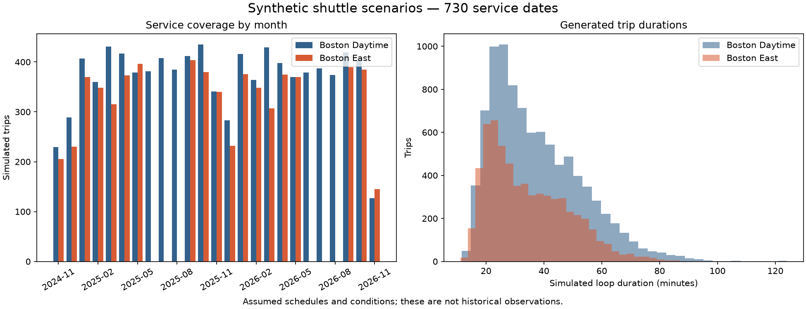

# Simulated trip data

Dates: **2024-11-12–2026-11-11** (730 dates). Seed: **1850**.

**Every record is synthetic. No rows were appended to real data.**

| Route | Active service days | Trips | GPS requests | ETA requests | Median trip (min) |
| --- | ---: | ---: | ---: | ---: | ---: |
| Boston Daytime | 546 | 9,224 | 690,554 | 6,905,540 | 33.9 |
| Boston East | 492 | 6,289 | 432,772 | 3,894,948 | 31.2 |

Total: **15,513 trips**, **1,123,326 GPS request records**, and **10,800,488 ETA request records**.

Files occupy approximately **347.4 MiB**, with compressed data files.

See [how the simulation works](../README.md) for the assumptions and commands.

The trips and ETA predictions are simulated. Use real trips to check whether
adding simulated examples helps the model.
